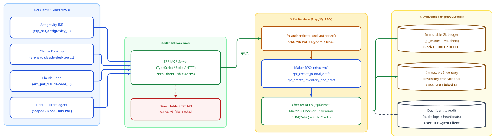

# Headless AI-Native ERP (Supabase + MCP Server)

🌐 **Language / ภาษา:** **English** | [ภาษาไทย (Thai)](./README.th.md)

> [!IMPORTANT]
> **Project Status: Work in Progress / Open for Fork & Adaptation**
> This project is under active development and is published as an **open-source reference implementation**. Anyone—developers, teams, or organizations—is welcome to **fork, clone, adapt, and extend** this repository to build their own custom AI-Native ERP on Supabase.

A **Headless AI-Native ERP** engineered with a **Ledger-First** philosophy, **Fat Database Pattern (PL/pgSQL RPC)**, **Dynamic Database-Driven RBAC (Maker-Checker separation of duties)**, and **1 User : Multiple Personal Agent Tokens (PAT)**—allowing multiple AI agents (Antigravity, Claude Desktop, Claude Code, DSH, or custom MCP clients) to safely operate on a single enterprise ledger concurrently.

---

## System Architecture Diagram



*Authored with [Pikchr](./docs/architecture.pikchr) — View [`docs/architecture.html`](./docs/architecture.html) | [Open Live Interactive Editor in Browser](https://htmlpreview.github.io/?https://github.com/um1981/Headless-AI-Native-ERP/blob/main/docs/architecture.html) | [High-DPI PNG](./docs/architecture.png)*

---

## 5 Core Architecture Rules

1. **Zero Direct Table Access/Mutation from Agent:**
   - Row-Level Security (RLS) is enabled across all 16 tables with strict `USING (false)` policies, completely blocking direct `SELECT`, `INSERT`, `UPDATE`, and `DELETE` calls via the PostgREST API—even when holding a valid `SUPABASE_ANON_KEY`.
2. **Fat Database Pattern (PL/pgSQL RPC):**
   - Every business operation and query is encapsulated inside PostgreSQL `SECURITY DEFINER` RPC functions (`rpc_*`) executing within strict ACID transaction boundaries and validating `ERP_AGENT_TOKEN` on every invocation.
3. **Ledger-First & Immutability:**
   - Posted records in `gl_entries`, `inventory_transactions`, and `audit_logs` are strictly immutable—protected by the `fn_block_mutation` PostgreSQL trigger that blocks `UPDATE` and `DELETE` operations 100%.
   - Corrections must be performed exclusively via reversal vouchers (`rpc_reverse_journal_voucher`) or adjustment documents.
   - Double-entry enforcement: Every GL voucher verifies `SUM(debit) = SUM(credit)` prior to commit.
4. **Supabase Free Tier Mitigations:**
   - Maintains an internal `audit_logs` table populated automatically via `fn_audit_trigger` across all tables (mitigating the 1-day log retention limit on Supabase Free Tier).
   - Includes `rpc_health_keepalive`, [`scripts/keepalive_and_backup.ps1`](./scripts/keepalive_and_backup.ps1), and a daily GitHub Actions workflow [`.github/workflows/supabase-keepalive-backup.yml`](./.github/workflows/supabase-keepalive-backup.yml) to prevent the 7-day inactivity pause and export daily JSON snapshots.
5. **Multi-Agent Authentication, Dynamic RBAC & Dual-Identity Auditability:**
   - **1 User : Multiple Personal Agent Tokens (PAT):** Each human user (`erp_users`) can issue multiple Personal Agent Tokens (`user_agent_tokens`, stored as SHA-256 hashes) per AI client (`antigravity`, `claude-desktop`, `claude-code`, `dsh`). Each token supports optional scope caps (`allowed_scopes`, e.g., read-only or draft-only) and individual revocation.
   - **Dynamic Database-Driven RBAC & Maker-Checker:** Roles (`roles`), permissions (`permissions`), policy constraints (`role_permissions` with `require_different_approver` and `max_approval_amount`), and assignments (`user_roles`) live in PostgreSQL tables and can be reconfigured at runtime without code changes.
   - **Dual-Identity Audit Trail:** Every transaction and `audit_logs` entry records both the human owner (`actor_user_id` / `actor_email`) and the specific AI client/token (`agent_client` / `token_id`) that executed the action.

---

## Self-Hosting Guide (Deploy on Your Own Supabase)

### Step 1: Create a Supabase Project & Run SQL Migrations
1. Create a new project on [Supabase](https://supabase.com).
2. Execute the SQL migration files inside [`supabase/migrations/`](./supabase/migrations/) in order (`0001` through `0005`) via the **Supabase SQL Editor** or Supabase CLI (`supabase db push`):
   - `202610200001_iam_rbac_and_audit_foundation.sql`
   - `202610200002_gl_inventory_and_sequences_schema.sql`
   - `202610200003_fat_database_rpc_functions.sql`
   - `202610200004_seed_rbac_coa_warehouses_and_initial_users.sql`
   - `202610200005_security_hardening_zero_direct_access.sql`

### Step 2: Bootstrap Your Initial Admin Token (PAT)
Because all RPC endpoints require a valid Personal Agent Token, run the following one-time snippet in the **Supabase SQL Editor** to mint your first Admin PAT for `admin@erp.local`:

```sql
DO $$
DECLARE
    v_raw_secret text := replace(gen_random_uuid()::text, '-', '') || substr(md5(random()::text || clock_timestamp()::text), 1, 16);
    v_plain_token text := 'erp_pat_admin_' || v_raw_secret;
    v_token_hash text := encode(pg_catalog.sha256(convert_to(v_plain_token, 'UTF8')), 'hex');
BEGIN
    INSERT INTO public.user_agent_tokens (
        user_id, client_name, token_prefix, token_hash, allowed_scopes, is_active, expires_at
    )
    SELECT
        u.id,
        'admin-cli',
        substr(v_plain_token, 1, 20) || '...',
        v_token_hash,
        NULL,
        true,
        now() + interval '365 days'
    FROM public.erp_users u
    WHERE u.email = 'admin@erp.local';

    RAISE NOTICE 'YOUR INITIAL ADMIN TOKEN (Save this securely!): %', v_plain_token;
END;
$$;
```
> Copy the `erp_pat_admin_...` token printed in the **Messages / Notices** tab and use it as your `ERP_AGENT_TOKEN`. Once connected, you can use the `erp_issue_agent_token` MCP tool to issue dedicated tokens for additional users and AI clients (`antigravity`, `claude-desktop`, `claude-code`, `dsh`).

---

### Step 3: Install & Configure the ERP MCP Server

```bash
cd mcp-server
cp .env.example .env
# Edit SUPABASE_URL, SUPABASE_ANON_KEY, and ERP_AGENT_TOKEN in .env
npm install
npm run build
```

#### Example AI Client Configuration (1 User : N Agent Tokens)

```json
{
  "mcpServers": {
    "headless-erp": {
      "command": "node",
      "args": ["/path/to/Headless-AI-Native-ERP/mcp-server/dist/index.js"],
      "env": {
        "SUPABASE_URL": "https://<your-project-ref>.supabase.co",
        "SUPABASE_ANON_KEY": "sb_publishable_<your_key>",
        "ERP_AGENT_TOKEN": "erp_pat_<client_name>_<your_secret_pat>"
      }
    }
  }
}
```

---

## PL/pgSQL RPC Reference (`rpc_*`)

| Module | RPC Function | Required Permission | Description |
|---|---|---|---|
| **IAM / RBAC** | `rpc_whoami(p_agent_token)` | *(Valid PAT)* | Inspect authenticated human user, AI agent client, assigned roles, and effective permissions |
| **IAM / RBAC** | `rpc_issue_agent_token(...)` | Self or `rbac.manage` | Issue a new Personal Agent Token (`erp_pat_<client>_...`) with optional scope caps |
| **IAM / RBAC** | `rpc_revoke_agent_token(...)` | Self or `rbac.manage` | Revoke a specific Personal Agent Token immediately |
| **IAM / RBAC** | `rpc_assign_user_role(...)` | `rbac.manage` | Create/update an ERP user and assign a role |
| **IAM / RBAC** | `rpc_configure_role_permission(...)` | `rbac.manage` | Configure role permissions, Maker-Checker enforcement, and approval amount limits |
| **General Ledger** | `rpc_create_gl_account(...)` | `gl.coa.manage` | Create or update Chart of Accounts (COA) entries |
| **General Ledger** | `rpc_create_journal_draft(...)` | `gl.voucher.draft` | Create a balanced `DRAFT` Journal Voucher (Maker) |
| **General Ledger** | `rpc_post_journal_voucher(...)` | `gl.voucher.post` | Approve and post a voucher into immutable `gl_entries` (Checker - enforces Maker-Checker) |
| **General Ledger** | `rpc_reverse_journal_voucher(...)` | `gl.voucher.reverse` | Reverse a posted voucher by generating a contra-entry voucher (`JVR-...`) |
| **General Ledger** | `rpc_get_trial_balance(...)` | `gl.report.read` | Generate a real-time Trial Balance report from `gl_entries` |
| **Inventory** | `rpc_create_item(...)` | `inventory.master.manage` | Create or update an inventory SKU and its GL account mapping |
| **Inventory** | `rpc_create_inventory_doc_draft(...)` | `inventory.movement.draft` | Create a `DRAFT` inventory movement document (`RECEIPT`, `ISSUE`, `ADJUSTMENT`) |
| **Inventory** | `rpc_post_inventory_doc(...)` | `inventory.movement.post` | Approve and post an inventory document into `inventory_transactions` with automatic GL posting |
| **Inventory** | `rpc_list_inventory_balances(...)` | *(Valid PAT)* | Query current on-hand quantity and moving average cost across warehouses |
| **Audit & Backup** | `rpc_list_audit_logs(...)` | `audit.read` | Query Dual-Identity Audit Logs (`actor_email` + `agent_client`) |
| **Audit & Backup** | `rpc_export_ledger_snapshot(...)` | `audit.read` | Export a complete JSON snapshot of ledgers, inventory, and audit logs for daily backup |
| **System** | `rpc_health_keepalive(...)` | Public / Cron | Record a heartbeat ping to prevent Supabase Free Tier 7-day inactivity pause |
